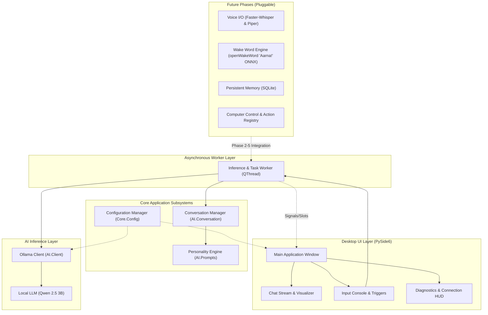

# Project AARNA — System Architecture

## 1. Architectural Philosophy

Project AARNA is designed as a **modular, local-first, privacy-respecting Windows desktop AI assistant** inspired by Iron Man's J.A.R.V.I.S.

The core architectural principles are:
1. **Decoupled Components**: Every subsystem (GUI, AI Engine, Memory, Voice, Vision, Automation) operates behind well-defined abstract interfaces. Replacing the AI inference provider (e.g. swapping Ollama for llama.cpp or an upgraded model) requires zero changes to the GUI or memory layer.
2. **Local-First & Privacy Guaranteed**: All user inputs, voice streams, session transcripts, and memory stores remain 100% on the local computer. No continuous cloud uploading.
3. **Responsive UI Threading**: All I/O, network requests, and AI inference run strictly on worker threads (`QThread`), ensuring 60 FPS UI responsiveness with zero freezes.
4. **Hardware-Conscious Resource Management**: Tuned specifically for a 6GB VRAM GPU (NVIDIA RTX 4050 Laptop). The LLM footprint is kept <= 3.5GB VRAM, leaving ample overhead for Windows graphics and future voice/vision models.

---

## 2. Component Diagram

---

## 3. Subsystem Breakdown

### 3.1 Desktop Interface (`src/ui/`)
- **Technology**: PySide6 (Qt 6 for Python).
- **Theme**: Futuristic dark theme with arc-reactor cyan accents, high-contrast typography, and smooth scrolling.
- **Threading Model**: The UI thread processes paint events and user interaction. Long-running actions (e.g., HTTP streaming to Ollama) are dispatched to `ChatWorker` using Qt signals and slots (`started`, `finished`, `error_occurred`, `chunk_received`).

### 3.2 AI Inference Client (`src/ai/client.py`)
- **Technology**: REST API client communicating with local Ollama daemon (`http://localhost:11434`).
- **Resilience**:
  - Automatically pings the daemon to report online/offline status.
  - Gracefully handles connection refused (Ollama offline) and model not found.
  - Supports configurable timeouts and multi-turn message payload formatting.

### 3.3 Conversation Manager (`src/ai/conversation.py`)
- **Responsibility**: Maintains the working multi-turn dialogue history for the current session.
- **Context Management**: Injects the AARNA system prompt and enforces a rolling token/message budget to prevent context window overflow.

### 3.4 Configuration Subsystem (`src/core/config.py`)
- Reads environment variables with defaults via `.env`.
- Centralizes model name, base URL, temperature, and UI preferences.
- Manages wake-word specifications (name: "AARNA", exact wake word: "Aarna", activation phrase: "Aarna!", prefix: none required).

---

## 4. Wake-Word Architecture: Standalone "Aarna!" (Phase 3 Requirement)

### 4.1 Product Specification
- **Assistant Name**: AARNA
- **Exact Wake Word**: `"Aarna"`
- **Spoken Activation**: `"Aarna!"`
- **Prefix Requirement**: The prefix "Hey" is **strictly NOT required**. The assistant triggers directly on `"Aarna"`.

### 4.2 Engineering Investigation: Custom Model Requirement
- **Off-The-Shelf Availability**: Pre-trained openWakeWord models only provide common public phrases (`hey_jarvis`, `alexa`, `hey_mycroft`, `marvin`, `timer`, `weather`). There is **no pre-existing off-the-shelf model for "Aarna"**.
- **Acoustic Characteristic of "Aarna"**:
  - Phonetic composition: `/ɑːr.nə/` (two syllables).
  - Standalone single-word wake phrases contain less phonetic duration/entropy than multi-word phrases (e.g., "Hey JARVIS").
  - As a result, detecting standalone "Aarna" without false alarms requires a specialized classifier trained with strong negative audio discrimination.
- **Conclusion**: **Yes, standalone "Aarna" requires a custom-trained wake-word model.**

### 4.3 Phase 3 Custom Model Training Pipeline
When Phase 3 commences, we will use openWakeWord's official synthetic training pipeline:
1. **Synthetic Speech Generation**: Generate ~5,000 to 10,000 audio samples of "Aarna" pronounced across 50+ diverse synthetic voices (varying accents, speaking rates, pitches, and micro-inflections) using Piper/Coqui TTS.
2. **Room Impulse Response (RIR) Augmentation**: Convolve audio samples with room acoustics (varying distances from 0.5m to 5m, reverberation, and room shapes).
3. **Hard Negative Mining**: Mix with 50+ hours of ambient room noise, background television speech, common English dialogue (from Common Voice), and phonetically similar words (e.g., "honor", "arm", "Anna", "arna") to prevent false triggers.
4. **Model Architecture**: Train a custom classification head on top of openWakeWord's shared Audio Spectrogram Transformer (AST) backbone.
5. **Deployment**: Export the trained model to an optimized ONNX file (`aarna.onnx`, ~3-5 MB) that executes locally with negligible CPU impact (< 1% CPU utilization on the Ryzen 7 7445HS).

---

## 5. Hardware Optimization for RTX 4050 (6GB VRAM)

| Component | Target Allocation | Notes |
| :--- | :--- | :--- |
| **Windows OS + Display** | ~500 MB - 1.0 GB | Baseline desktop usage |
| **Qwen 2.5 3B (Q4_K_M)** | ~2.0 GB - 2.5 GB | Fully offloaded to GPU VRAM for maximum tokens/sec |
| **Context KV Cache** | ~400 MB | 4K-8K token context buffer |
| **Future Voice/Vision** | ~1.5 GB | Faster-Whisper tiny/base + Piper + OpenCV buffer |
| **Safety Margin** | ~500 MB | Prevents CUDA out-of-memory (OOM) crashes |
