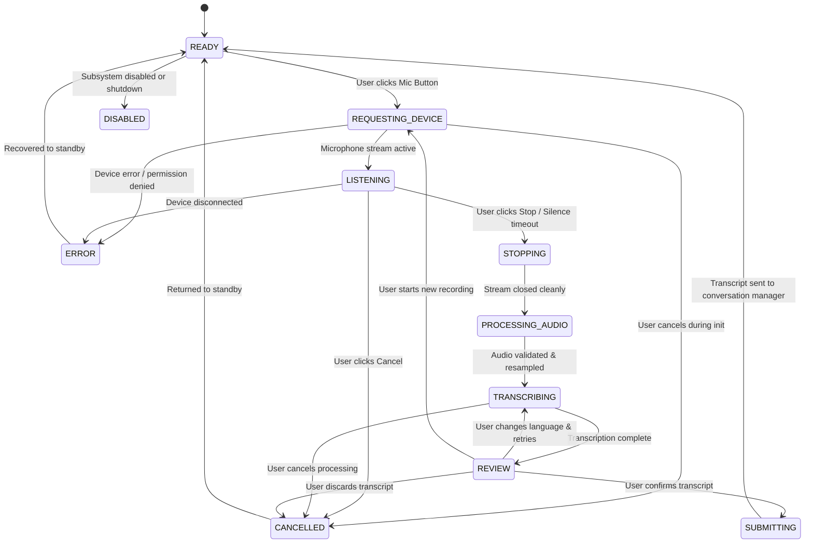

# AARNA — Phase C: Voice Input Architecture Specification

> [!NOTE]
> **Status**: Architectural Specification & Implementation Blueprint.
> **Current Milestone**: Phase C1 Foundation Hardening completed (`src/voice/` core types, configuration, models, state machine, and interfaces).
> Subsequent subphases (C2 Audio Devices, C3 Capture, C4 Audio Processing/VAD, C5 Faster-Whisper Engine, C6 Controller, C7 UI Integration, C8 Avatar, C9 Conversation Pipeline, C10 Reliability, C11 Final Docs) will implement remaining components sequentially upon explicit approval.

---

## 1. System Vision & Core Design Rules

Phase C establishes a production-grade, local-first, privacy-preserving speech-to-text input system for **Project AARNA**.

### Core Invariants:
1. **Strict Offline Privacy**: All audio capture, signal processing, and speech-to-text recognition execute 100% locally on the host workstation. Zero audio frames, embeddings, or transcripts are ever transmitted to cloud endpoints.
2. **Push-to-Talk & Review**: Voice input is initiated strictly by the user via explicit push-to-talk. The microphone is never activated automatically on startup, never records continuously in the background, and all recognized speech must be presented in an editable review component before entering the conversation pipeline.
3. **No GUI Blocking**: Audio capture, stream initialization, model loading, and speech inference are isolated in asynchronous background workers (`QThread`), keeping the PySide6 UI at a responsive 60 FPS.
4. **Hardware-Conscious Resource Management**: Defaults to CPU execution with `INT8` quantization on the 6-core / 12-thread AMD Ryzen 7 7445HS. This ensures zero VRAM or CUDA contention with the local Ollama LLM (`qwen2.5:3b`, ~2.5 GB VRAM) and the 3D Three.js companion stage (~180 MB VRAM). CUDA execution remains optional and benchmark-verified.
5. **Canonical Nomenclature**: Assistant name is **AARNA**, standalone wake word is **`Aarna`**, and activation phrase is **`Aarna!`** (never "Hey Aarna" or "JARVIS"). Wake-word detection and text-to-speech are strictly deferred to future phases.

---

## 2. Directory Structure & Implementation Status

```text
src/voice/
├── __init__.py                      # [IMPLEMENTED - C1] Public package exports
├── config.py                        # [IMPLEMENTED - C1] VoiceConfig dataclass with strict cross-validation
├── exceptions.py                    # [IMPLEMENTED - C1] Categorized VoiceError hierarchy with sanitized user messages
├── models.py                        # [IMPLEMENTED - C1] AudioDeviceInfo, RawAudioBuffer, ProcessedAudio, TranscriptionResult
├── state.py                         # [IMPLEMENTED - C1] VoiceStateMachine with lock-free callbacks & retry routing
├── interfaces.py                    # [IMPLEMENTED - C1] AudioCaptureBackend & TranscriptionBackend contracts
├── controller.py                    # [PLANNED - C6] VoiceController coordinating states, workers, and UI
├── workers.py                       # [PLANNED - C6] AudioCaptureWorker and TranscriptionWorker (QThread)
├── setup_models.py                  # [PLANNED - C5] Explicit local Whisper model downloader
├── audio/
│   ├── __init__.py                  # [PLANNED - C2]
│   ├── devices.py                   # [PLANNED - C2] AudioDeviceManager (device filtering, deduplication)
│   ├── capture.py                   # [PLANNED - C3] AudioCaptureSession (bounded memory buffer, overflow protection)
│   ├── processing.py                # [PLANNED - C4] AudioProcessor (downmix mono, anti-aliased resample to 16 kHz)
│   └── vad.py                       # [PLANNED - C4] VoiceActivityDetector (energy + hysteresis speech tracking)
└── stt/
    ├── __init__.py                  # [PLANNED - C5]
    ├── model_manager.py             # [PLANNED - C5] WhisperModelManager (local model storage and lazy loading)
    └── faster_whisper_engine.py     # [PLANNED - C5] FasterWhisperEngine (CTranslate2 backend)

src/ui/
└── voice_panel.py                   # [PLANNED - C7] VoiceRecordingPanel & TranscriptReviewWidget
```

---

## 3. Dedicated Voice State Machine (`src/voice/state.py`)

The subsystem is governed by a thread-safe finite state machine with 11 distinct states:



### Key Semantics:
- **Lock-free Callback Dispatch**: Transition callbacks are executed strictly outside internal re-entrant locks (`threading.RLock`) to guarantee zero UI deadlocks.
- **Review Retries**: The `REVIEW -> TRANSCRIBING` transition enables re-running recognition with a forced language (e.g. switching from Auto to Hindi) without re-recording audio.
- **Resource Protection**: Transitions to `READY` verify that background worker threads and audio streams have completely terminated before returning to standby.

---

## 4. Hardware Profile & Target Performance

- **Host Workstation**: Windows 11 build 26200, AMD Ryzen 7 7445HS (6 cores / 12 threads), 16 GB RAM.
- **GPU**: NVIDIA GeForce RTX 4050 Laptop GPU (6 GB dedicated VRAM).
- **Default Audio Capture**: Native sampling rate (typically 44.1 kHz or 48.0 kHz) resampled via anti-aliased interpolation to standard 16.0 kHz mono float32 for recognition.
- **Whisper Inference Strategy**:
  - Baseline: CTranslate2 CPU execution with `int8` quantization.
  - Model Selection: Benchmark comparison between `small` and `base` during subphase C5.
  - Optional CUDA: Evaluated only when runtime CUDA DLLs are confirmed and verified not to exceed the 6 GB VRAM budget alongside Ollama.
